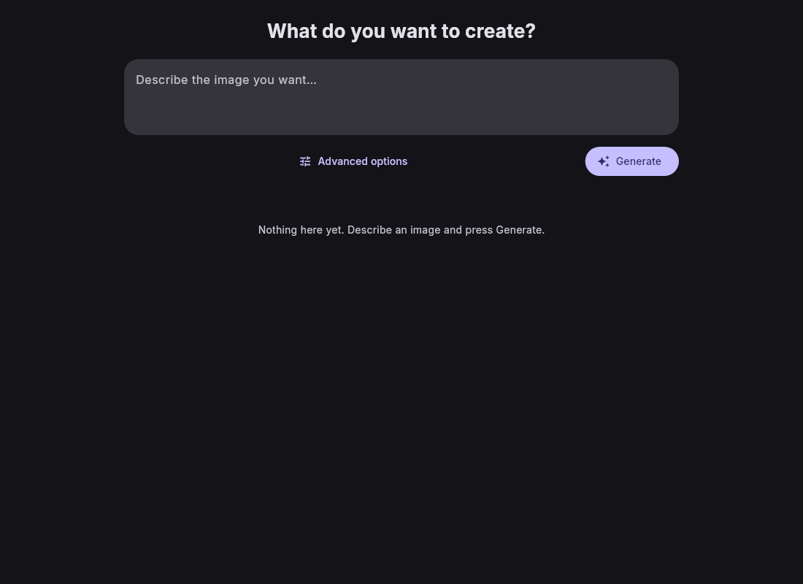
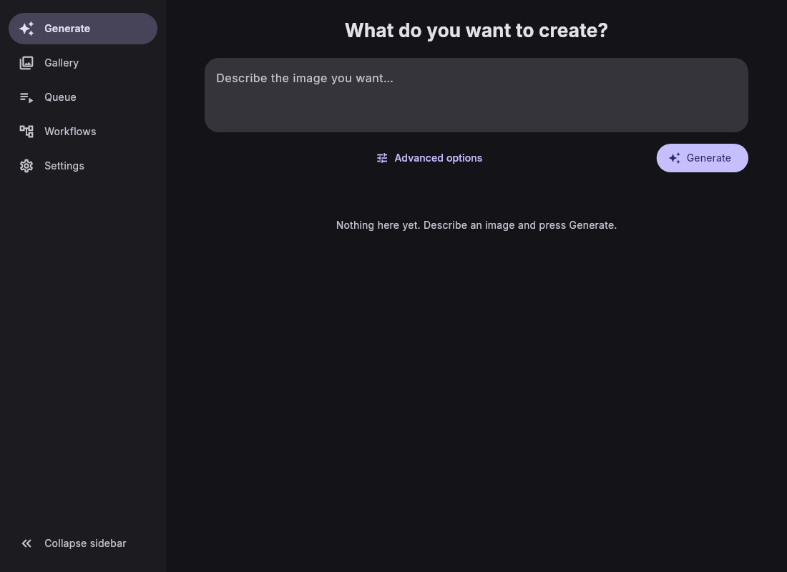

# SimpleUI

[](https://gitlab.com/HttpAnimations/simpleui/-/pipelines)
[](https://gitlab.com/HttpAnimations/simpleui/-/releases)
[](LICENSE)
[](https://httpanimations.gitlab.io/simpleui/)

A simple client for ComfyUI. Describe the image you want, press Generate, get a result. It feels like typing into Gemini, but it runs against your own ComfyUI server.

**Landing page:** https://httpanimations.gitlab.io/simpleui/ (the web app lives at `/app/`).

## What it does

- One prompt box for txt2img. Seed, size, steps, CFG, sampler, scheduler and batch controls under a collapsible panel.
- Works on Linux, macOS, Windows, Android, iOS and in the browser.
- Point it at any ComfyUI instance, local or remote. It lists the checkpoints your server has.
- Live progress over the ComfyUI websocket, a queue view, and a gallery of everything you made.
- Import ComfyUI workflow JSONs and run them with your own prompts.
- It checks for updates from Settings and links straight to the release notes.

## Screenshots





## Install

Grab a build from the [releases page](https://gitlab.com/HttpAnimations/simpleui/-/releases) or from the [landing page](https://httpanimations.gitlab.io/simpleui/).

### Linux (Flatpak)

```
flatpak install https://httpanimations.gitlab.io/simpleui/simpleui.flatpakref
```

Or add the repo by hand:

```
curl -fLO https://httpanimations.gitlab.io/simpleui/flatpak/key.gpg
flatpak remote-add --if-not-exists --gpg-import=key.gpg simpleui https://httpanimations.gitlab.io/simpleui/flatpak
flatpak install simpleui gitlab.httpanimations.simpleui
```

### iOS (AltStore)

Add the source `https://gitlab.com/HttpAnimations/simpleui/-/raw/main/repos/altstore.json` in AltStore, then install SimpleUI.

## License

[AGPL-3.0](LICENSE)
